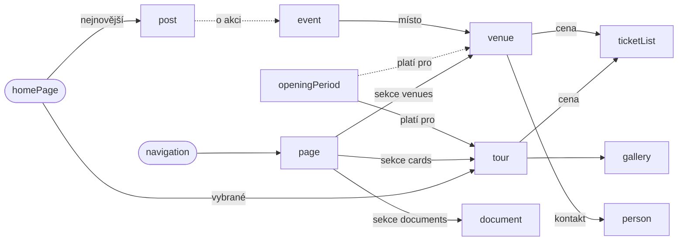

# 02 – Sanity model, vztahy a page builder

## Obsahový model Sanity

### Singletony

| Název | Typ ve Studiu | Hlavní pole | Reference | Použití na webu |
| --- | --- | --- | --- | --- |
| siteSettings | Nastavení webu | Název organizace (Správa zámku Rosice, p. o.), zřizovatel, adresa, GPS (geopoint), telefony, e-mail, IČ, bankovní spojení, sociální sítě, výchozí SEO (titulek, popis, OG obrázek) | – | Footer, Kontakt, JSON-LD, hlavička |
| navigation | Navigace | Hlavní menu (štítek, odkaz, podmenu do 2 úrovní), sloupce patičky, právní odkazy, tlačítko v liště | page, tour, venue, gallery (odkaz = reference nebo externí URL) | Nav, dropdown, Footer |
| homePage | Úvodní stránka | Hero (nadpis, podnadpis, foto nebo video, tlačítko), úvodní text, vybrané prohlídky, počet aktualit, SEO (stránka je v kódu, bez page builderu) | tour[], post[], gallery | Hero, Intro, Signpost, News |
| visitInfo | Provoz a oznámení | Plovoucí oznámení (text, tón, platí od–do, odkaz), jak se k nám dostanete (auto, vlak, autobus, parkování), bezbariérovost, poznámka k nákupu vstupenek | page | Lišta oznámení, Kde nás najdete, Map |

### Dokumenty

| Název | Typ ve Studiu | Hlavní pole | Reference | Použití na webu |
| --- | --- | --- | --- | --- |
| page | Stránka | Titulek, slug (v každém jazyce vlastní), rodič (reference na page), perex, hlavní obrázek, sections[] (lehký page builder jen pro obecné textové stránky), SEO, language | page (rodič), sekce odkazují na ostatní typy | Obecné textové stránky v page builderu: Historie, Projekty, Pronájmy (Svatby, Šenk, Výstavy), Školní výlety, Návštěvní řád, právní texty a budoucí stránky |
| tour | Prohlídka / expozice | Titulek, slug, druh (okruh, stálá výstava, venkovní, doplňkový), perex, text, délka v minutách, pravidlo začátku (např. Hausperský v lichou hodinu), zdarma ano/ne, obrázky, pořadí, SEO | ticketList, gallery, openingPeriod (zpětně) | Detail prohlídky, Programme/Card, Signpost |
| ticketList | Ceník | Název, platí pro (reference), řádky (štítek, cena jako číslo, podmínka, druh: plné, snížené, rodinné, skupinové), poznámka | tour[], venue[] | Pricing |
| openingPeriod | Provozní doba (období) | Štítek, platí pro (reference), od–do (datum), dny (denně, víkendy, svátky, pracovní dny), otevřeno od–do, poslední vstup, pravidlo začátků, zavřeno ano/ne, poznámka | tour[], venue[] | Hours, JSON-LD OpeningHoursSpecification |
| venue | Prostor k pronájmu | Název, slug, využití (obřad, svatba, oslava, seminář, výstava), kapacita (číslo + text), popis, vybavení, sezónní omezení (Šenk ne listopad–duben), fotky, pořadí | ticketList, person (kontakt), gallery | Halls/CardHall, Svatby, Šenk, Výstavy |
| post | Aktualita | Titulek, slug, datum, hlavní obrázek (alt), perex (max 300 znaků), tělo (blockContent), kategorie, zobrazit na úvodu, SEO | event (volitelně) | News/CardNews, detail aktuality |
| event | Akce (nový typ, rozhodnutí) | Titulek, slug, datum od–do, čas jako text, místo, popis, obrázek, cena, odkaz na vstupenky, stav (konáno, zrušeno), SEO | venue | Program/CardProgram, JSON-LD Event |
| gallery | Fotogalerie | Název, slug, obrázky[] (foto, alt, popisek, autor), výchozí autor (fotoarchiv Správy zámku, Aleš Palek) | tour, venue | Gallery |
| document | Dokument ke stažení | Název, kategorie (závěrečná zpráva, rozpočet, výhled, objednávka a ceník, ostatní), rok, soubor, platí do | – | Statutární informace, Svatby (objednávka a ceník) |
| project | Dotovaný projekt | Název, žadatel, reg. číslo, dotační program, výdaje celkem a způsobilé, míra podpory, klíčové aktivity[], loga | – | Povinná publicita projektů |
| person | Kontaktní osoba | Jméno, funkce, telefon, e-mail, foto, pořadí | – | Contact/CardContact |
| partner | Partner zámku | Název, popis činnosti, web, logo, pořadí | – | Logos |
| mediaMention | Zámek v médiích | Název, médium, datum, URL, typ (video, článek, podcast, TV), případně YouTube embed | – | Seznam odkazů |
| faq | Časté otázky (návrh) | Otázka, odpověď, kategorie, pořadí – převzít schéma z balonhotel-site | – | Faq (ve Figmě není, volitelné) |

### Objekty

| Název | Typ ve Studiu | Hlavní pole | Reference | Použití na webu |
| --- | --- | --- | --- | --- |
| localizedString, localizedText | Lokalizovaný text | Objekt s poli cs, en, de (při publikaci povinné všechny tři) | – | Štítky a poznámky v ceníku a provozní době, funkce osob, popisy partnerů |
| seo | SEO | metaTitle, metaDescription (max 160), ogImage, noindex, canonical (volitelně) | – | BaseHead |
| imageWithAlt | Obrázek s popisem | asset (hotspot), alt, popisek, autor / licence | – | Img |
| link, cta | Odkaz a tlačítko | Štítek, druh (interní reference, externí URL, soubor, tel:, mailto:), varianta tlačítka | page, tour, venue, post, document | Button |
| blockContent | Formátovaný text | Převzít z balonhotel-site: odstavec, mezinadpis, citace, odrážky, obrázek, dvojice obrázků, výrazná citace. Doplnit: tabulka, odkaz na soubor, YouTube | – | PortableText, RichText |

Konvence převzaté z balonhotel-site: pole se jmenují anglicky, popisky ve Studiu česky, slug z titulku (max 96 znaků), obrázky s hotspot a polem alt, pole order pro ruční pořadí, ceny a kapacity v balonhotelu jako text. Pro Rosice navrhuji u cen číslo (kvůli JSON-LD a řazení) a text jen v poznámce.

Hybridní přístup (rozhodnuto): úvod, prohlídky, vstupné a provozní doba, kontakt, aktuality, akce a galerie jsou stránky v kódu, které čtou strukturované typy (homePage, tour, ticketList, openingPeriod, siteSettings, person, post, event, gallery). Typ page se sekcemi slouží jen pro obecné textové stránky; sekce se nikdy nepoužívají k sestavení klíčových stránek.

Jazyky (rozhodnuto): cs, en, de. Přeložitelné dokumenty (page, tour, venue, post, event, gallery, faq) mají pole language a překladová metadata; strukturovaná data (ceny, hodiny) jsou společná a texty v nich jsou lokalizované pole, aby se čísla a data nezadávala třikrát. Podrobnosti v sekci Jazyky.

Studio: singletony jako položky Nastavení webu, Navigace, Úvodní stránka, Provoz a oznámení; pod čárou Stránky, Prohlídky, Ceníky, Provozní doba, Prostory, Aktuality, Akce, Fotogalerie, Dokumenty, Projekty, Lidé, Partneři, Média. Presentation tool dostane pro každý typ místa zobrazení (locations) jako v balonhotelu.

## Vztahy mezi typy

## Sekce page builderu a komponenty

Sekce jsou pole sections[] jen na typu page (obecné textové stránky); klíčové stránky jsou v kódu a stejné komponenty používají přímo, bez sections[]. Sloupec Komponenta uvádí odpovídající komponentu z balonhotel-site (ta vznikla z jeho Figmy); mapování na komponenty z Figmy Rosic je v následující sekci.

| Sekce | Komponenta | Pole | Kde se použije |
| --- | --- | --- | --- |
| hero | ContentHeroMain | Nadpis, eyebrow, text, foto nebo video, tlačítko | Úvod, rozcestníky |
| intro | ContentIntroMain | Text, tlačítko, monogram | Úvod, O zámku |
| richText | ContentWrapper + RichText | blockContent | Historie, Návštěvní řád, právní texty |
| signpost | ContentSignpostMain | Řádky: štítek, odkaz (reference), obrázek | Úvod, Navštivte nás, Akce a možnosti |
| cards | ContentProgrammeMain, Card | Ruční výběr referencí nebo automaticky podle druhu (tour, venue) | Přehled prohlídek, prostory k pronájmu |
| pricing | ContentPricingMain | Reference na ticketList[] | Vstupné, detail prohlídky, školní výlety |
| hours | ContentHoursMain | Reference na openingPeriod nebo filtr podle prohlídky | Vstupné a otevírací doba, Kontakt |
| gallery | ContentGalleryMain | Reference na gallery nebo vložené fotky | Detaily, Svatby, Šenk |
| news | ContentNewsMain | Počet, kategorie | Úvod, Aktuality |
| events | nová, vzor CardProgram | Počet, filtr budoucích akcí | Úvod, Akce (jen když bude typ event) |
| venues | ContentHallsMain, CardHall | Reference na venue[], filtr podle využití | Svatby, Šenk, Výstavy |
| contact | ContentContactMain, CardContact | Reference na person[], údaje ze siteSettings | Kontakt, Svatby, Školní výlety |
| map | ContentMapMain | Souřadnice, odkaz na Mapy.cz, způsoby dopravy | Kde nás najdete, Kontakt |
| timeline | ContentHistoryMain | Položky: rok, text, obrázek | Z historie |
| documents | nová | Reference na document[], seskupení podle roku nebo kategorie | Statutární informace, Svatby |
| partners | ContentLogosMain | Reference na partner[] | Partneři zámku, Úvod |
| faq | ContentFaqMain, Accordion | Reference na faq[] | Návštěvní informace (volitelně) |
| cta | ContentCtaMain | Eyebrow, nadpis, primární a sekundární tlačítko | Konec většiny stránek |
| social | ContentInstagramMain | Zdroj (Facebook nebo Instagram), příspěvky ručně | Úvod (rozhodnout) |
| notice | nová | Text, tón, platnost od–do | Lišta oznámení, detail prohlídky |

> **INFO: Rozhodnuto: hybrid** Klíčové stránky jsou v kódu jako v balonhotel-site, page builder je jen pro obecné textové stránky (historie, projekty, pronájmy a budoucí stránky). Úprava textu Svateb nebo Historie tak nevyžaduje nasazení, zatímco struktura úvodu, prohlídek, cen a hodin zůstává pod kontrolou kódu.

---

[← README](../README.md)
