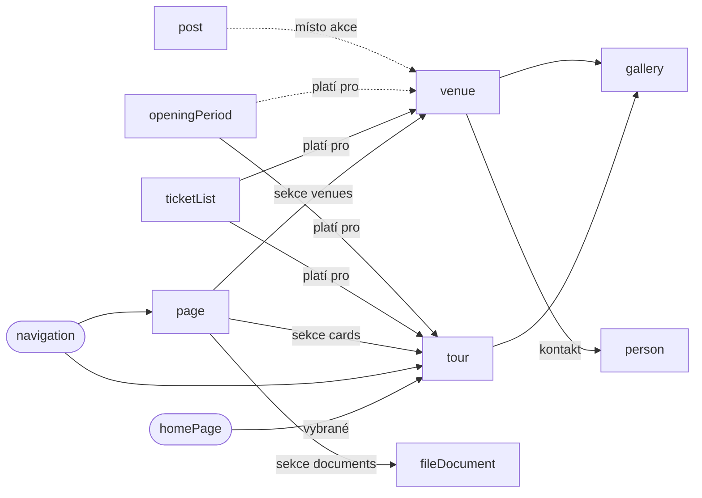

# 02 – Sanity model, vztahy a page builder

Revidováno 10. 11. 2026, viz [09-revize.md](09-revize.md). Schémata jsou v `src/sanity/schemas/`.

## Jak se překládá

| Způsob | Typy | Slug |
| --- | --- | --- |
| **Dokument na jazyk** (pole `language`, plugin `@sanity/document-internationalization`) | `page`, `post` | vlastní v každém dokumentu |
| **Jeden dokument, lokalizovaná pole** | `tour`, `venue`, `gallery`, `faq`, `ticketList`, `openingPeriod`, `person`, `partner`, `project`, `fileDocument`, singletony | `localizedSlug` (cs, en, de) tam, kde má typ vlastní stránku |
| **Bez překladu** | `mediaMention` | – |

Reference na `page` a `post` míří vždy na český dokument; překlad se dohledá přes `translation.metadata`.

## Singletony

Každý je jeden dokument s pevným ID, texty v lokalizovaných polích.

| Název | Typ ve Studiu | Hlavní pole | Použití na webu |
| --- | --- | --- | --- |
| `siteSettings` | Nastavení webu | Název organizace, zřizovatel, adresa, GPS, telefony, e-mail, e-mail pro formulář, IČ, bankovní spojení, sociální sítě, hodnocení (hodnota, zdroj, odkaz), výchozí SEO | Patička, Kontakt, JSON-LD |
| `navigation` | Navigace | Tři skupiny hlavního menu (štítek + položky), odkazy v horní liště, tři sloupce patičky, právní odkazy | Nav, dropdown, patička |
| `homePage` | Úvodní stránka | Nadpis (h1), odkaz pod nadpisem, hero fotka, vybrané prohlídky, promo bloky (nadpis, text, fotka, odkaz), citace (text, autor, datum), CTA, SEO | Úvod |
| `visitInfo` | Provoz a oznámení | `notices[]` (text, tón, platí od–do, odkaz), doprava (auto, vlak, autobus), parkování, bezbariérovost, poznámka ke vstupenkám | Lišta oznámení, Kde nás najdete |

## Dokumenty

| Název | Typ ve Studiu | Hlavní pole | Reference |
| --- | --- | --- | --- |
| `page` | Stránka | `language`, titulek, slug, perex, hlavní obrázek, `sections[]`, SEO | sekce odkazují na ostatní typy |
| `post` | Aktualita / akce | `language`, `kind` (`news`, `event`), titulek, slug, datum zveřejnění, obrázek, perex (max 300), tělo, `featured`, pole akce (`eventStart`, `eventEnd`, `eventTimeNote`, `eventPlace`, `eventPrice`, `eventTicketUrl`, `eventStatus`), SEO | `venue` (místo akce, volitelně) |
| `tour` | Prohlídka / expozice | Titulek, slug, druh (okruh, stálá výstava, venkovní), štítek nad nadpisem, perex, text, délka (min–max minut nebo „není omezená“), zdarma, obrázky, pořadí, zobrazit na úvodu, SEO | `gallery` |
| `ticketList` | Ceník | Název, úvodní text, platí pro, řádky (štítek, podmínka, ceny[], jednotka), poznámka, pořadí, `showInStatusBar` | `tour[]`, `venue[]` |
| `openingPeriod` | Provozní doba (období) | Štítek, `kind` (`regular`, `exception`), platí pro, od–do, dny, zavřeno, otevřeno od–do, poslední vstup, `startRule` + `startTimes[]`, poznámka, `priority` | `tour[]`, `venue[]` |
| `venue` | Prostor k pronájmu | Název, slug, využití, kapacita (číslo + poznámka), popis, vybavení, měsíce mimo provoz, fotky, pořadí | `ticketList`, `person`, `gallery` |
| `gallery` | Fotogalerie (album) | Název, slug, obrázky[] (foto, alt, popisek, autor), výchozí autor, pořadí | – |
| `fileDocument` | Dokument ke stažení | Název, kategorie, rok, soubor (případně soubor pro en a de), platí do | – |
| `project` | Dotovaný projekt | Název, žadatel, reg. číslo, dotační program, výdaje celkem a způsobilé, míra podpory, klíčové aktivity[], loga | – |
| `person` | Kontaktní osoba | Jméno, funkce, telefon, e-mail, foto, pořadí | – |
| `partner` | Partner zámku | Název, popis, web, logo, pořadí, zobrazit v patičce | – |
| `mediaMention` | Zámek v médiích | Název, médium, datum, URL, typ (video, článek, podcast, TV) | – |
| `faq` | Časté otázky | Otázka, odpověď, kategorie, pořadí | – |

Typ se jmenuje `fileDocument`, ne `document`: název `document` je v Sanity vyhrazený.

## Objekty

| Název | Hlavní pole | Poznámka |
| --- | --- | --- |
| `localizedString`, `localizedText` | `cs`, `en`, `de` | Při publikaci povinné všechny tři (varianta `optional` jen cs) |
| `localizedSlug` | `cs`, `en`, `de` (slug) | Unikátní v rámci typu a jazyka |
| `localizedBlockContent` | `cs`, `en`, `de` (blockContent) | Delší texty strukturovaných typů |
| `seo` | metaTitle, metaDescription (max 160), ogImage, noindex | Lokalizovaná pole |
| `imageWithAlt` | asset (hotspot), **alt (povinný)**, popisek, autor | Alt lokalizovaný |
| `link` | Štítek, druh (interní reference, externí URL, soubor, tel, e-mail) | – |
| `blockContent` | Odstavec, mezinadpis h2–h4, citace, odrážky, odkaz, obrázek | `h1` není k dispozici, patří titulku stránky |

## Provozní doba

`openingPeriod` popisuje jedno pravidlo. Vyhodnocuje je `src/utils/opening.ts`.

| Pole | Hodnoty | Příklad |
| --- | --- | --- |
| `kind` | `regular`, `exception` | Velikonoce 3.–6. 4. = `exception` |
| `dateFrom`, `dateTo` | datum | 1. 5.–31. 5. |
| `days` | `daily`, `weekdays`, `weekends`, `holidays`, `weekendsAndHolidays` | duben: `weekendsAndHolidays` |
| `closed` | ano/ne | zahrada leden–březen |
| `opens`, `closes`, `lastEntry` | `HH:MM` | 10:00, 16:00, 15:00 |
| `startRule` | `none`, `everyHour`, `oddHours`, `evenHours`, `listed` | Hausperský = `oddHours`, Žerotínský = `evenHours` |
| `startTimes[]` | `HH:MM`, jen pro `listed` | Dětský okruh: 10:00, 12:00, 14:00 |
| `priority` | číslo | rozhodne shodu |

Přednost, když na jeden den sedí víc pravidel:

1. `exception` před `regular`,
2. kratší rozsah dat před delším,
3. vyšší `priority`.

Svátky se nezadávají: státní svátky ČR včetně Velkého pátku a Velikonočního pondělí počítá kód. Časové pásmo je `Europe/Prague`.

## Ceník

Řádek má pole `prices[]`, protože některé řádky mají dvě ceny (Kombinované vstupné 340 / 240 Kč). Cena je číslo; jednotka (`Kč`, `Kč / hod`) je zvlášť. Ceník s `showInStatusBar` dává liště první dvě ceny (plné / snížené).

## Vztahy mezi typy

## Sekce page builderu

Sekce jsou pole `sections[]` jen na typu `page`. Klíčové stránky jsou v kódu a stejné komponenty používají přímo.

| Sekce | Pole | Kde se použije |
| --- | --- | --- |
| `sectionRichText` | blockContent | Historie, Návštěvní řád, právní texty |
| `sectionMedia` | Obrázek nebo dvojice, popisek | Všechny textové stránky |
| `sectionPricing` | Reference na `ticketList[]` | Školní výlety, Svatby |
| `sectionVenues` | Reference na `venue[]` | Svatby, Šenk, Výstavy |
| `sectionGallery` | Reference na `gallery` | Svatby, Šenk |
| `sectionDocuments` | Reference na `fileDocument[]` | Svatby, Statutární informace |
| `sectionContact` | Reference na `person[]` | Svatby, Školní výlety |
| `sectionCta` | Nadpis, odkaz, obrázek | Konec stránky |

První verze page builderu má jen tyto sekce. Další (`timeline`, `faq`, `partners`) přibudou, až je bude potřeba; do té doby se nedělají.

---

[← README](../README.md)
